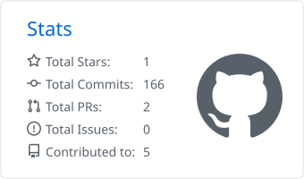
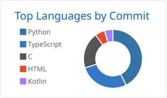

 

## About

I run operations at **AiGenX Labs** and lead our cloud and DevOps work: containerised
deployments, CI/CD and infrastructure as code. I also build full-stack products end to end.

## Tech Stack

**Languages** 

**Web and Data** (Valkey / Redis) 

**Cloud and Infrastructure** 

## Featured Projects

<table>
  <tr>
    <td width="50%" valign="top">
      <b><a href="https://github.com/vimu-nk/plain-post">plain-post</a></b> 
      Dark-themed full-stack blogging platform. Next.js, Supabase, PostgreSQL.
    </td>
    <td width="50%" valign="top">
      <b><a href="https://github.com/vimu-nk/llm-backend">llm-backend</a></b> 
      Flask API that answers questions with GPT, running on a GCP Compute Engine VM with the key kept out of code.
    </td>
  </tr>
  <tr>
    <td valign="top">
      <b><a href="https://github.com/vimu-nk/video-encoder">video-encoder</a></b> 
      Dashboard to browse Bunny CDN storage and run video encoding jobs with live status. Python, Shell.
    </td>
    <td valign="top">
      <b><a href="https://github.com/vimu-nk/llm-cli">llm-cli</a></b> 
      Python CLI that asks GPT-4o questions from the terminal.
    </td>
  </tr>
  <tr>
    <td valign="top">
      <b><a href="https://github.com/vimu-nk/aigenxlabs-web">aigenxlabs-web</a></b> 
      Responsive marketing site for AI GenX Labs. HTML, CSS, JavaScript.
    </td>
    <td valign="top">
      <b><a href="https://github.com/vimu-nk/drop-adgen-demo">drop-adgen-demo</a></b> · <b><a href="https://github.com/vimu-nk/stream-auth-app">stream-auth-app</a></b> 
      Next.js and TypeScript demos.
    </td>
  </tr>
</table>

## GitHub Activity

<picture>
  <source media="(prefers-color-scheme: dark)" srcset="./profile-summary-card-output/github_dark/3-stats.svg">
  
</picture>
<picture>
  <source media="(prefers-color-scheme: dark)" srcset="./profile-summary-card-output/github_dark/2-most-commit-language.svg">
  
</picture>

<picture>
  <source media="(prefers-color-scheme: dark)" srcset="https://raw.githubusercontent.com/vimu-nk/vimu-nk/output/github-contribution-grid-snake-dark.svg">
  
</picture>

